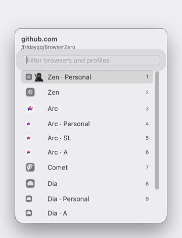

# Browser Zero

A macOS menu-bar "browser chooser". Instead of asking *which browser*, it asks *where*: a browser, or a specific Arc space, Zen workspace or Chromium profile. Links that match a rule open immediately; everything else gets a quick picker that already knows the likely answer.

<p align="center"></p>

## Features

- **Targets:** every Arc space, Zen workspace and Chromium profile is its own row ("Arc · Dev"), plus a plain row per browser. Discovery is automatic and cached.
- **Rules:** match by URL host glob (`*.atlassian.net`) and/or source app (Teams, Outlook, Telegram…). A matching rule opens without a picker.
- **Learning:** remembers your choices per host and source app, preselects the likely target, and after three identical choices offers "Always open <host> in <target>?".
- **Type-to-filter picker:** appears at the cursor. Type to filter, ↑/↓ to select, Enter to open, 1–9 for a row (when the search field is empty), ⌘C to copy the cleaned URL, Esc to cancel.
- **Link cleaning:** unwraps Outlook/Teams SafeLinks, Google, Slack, Facebook redirect wrappers and strips tracking parameters (`utm_*`, `fbclid`, `gclid`, …). Can be turned off in settings.
- **Force the picker:** hold Option while a link arrives to bypass rules.
- Every failure path falls back to opening the link in the target browser, so a link is never lost.

## Build

Requires only the Xcode Command Line Tools (no Xcode). The build is pinned to the macOS 26.5 SDK, because the macOS 27 SDK's SwiftUI `@State` macro plugin is not available under Command Line Tools.

```sh
scripts/build-app.sh
```

This produces `build/BrowserZero.app`, ad-hoc signed.

## Install

```sh
pkill -x BrowserZero
rm -rf /Applications/BrowserZero.app
cp -R build/BrowserZero.app /Applications/
open /Applications/BrowserZero.app
```

Then open Settings (⌘, while the app is focused, or open the app again from Finder) and click **Set as Default Browser** under General. Browser Zero never changes the default browser on its own.

## Browser setup

**Zen.** Each workspace needs its own default container, because that is how a workspace is targeted:

1. Give every workspace a default container (workspace settings in Zen).
2. Install the "Open external links in a container" add-on.
3. In `about:config`, set `zen.workspaces.force-container-workspace` to `true`.

The Targets tab shows a checklist of these items. Until they are satisfied, links open in Zen without targeting a workspace.

**Arc.** The first time Browser Zero opens a link in an Arc space, macOS asks for Automation permission for Arc. Allow it. The build is ad-hoc signed, and that signature changes on every rebuild, so macOS may ask for Automation permission again after you rebuild.

**Chrome.** Reading Chrome's profile list requires Full Disk Access: System Settings → Privacy & Security → Full Disk Access → enable Browser Zero, then press Rescan in the Targets tab. Until then the last known profiles are kept.

## Data

Stored in `~/Library/Application Support/BrowserZero/`:

- `config.json`: rules, hidden targets, settings
- `targets-cache.json`: discovered targets
- `history.json`: learned choices

## Tests

```sh
SDKROOT=/Library/Developer/CommandLineTools/SDKs/MacOSX26.5.sdk swift test -Xswiftc -plugin-path -Xswiftc /Library/Developer/CommandLineTools/usr/lib/swift/host/plugins/testing
```

The tests use Swift Testing; XCTest does not build under Command Line Tools.
